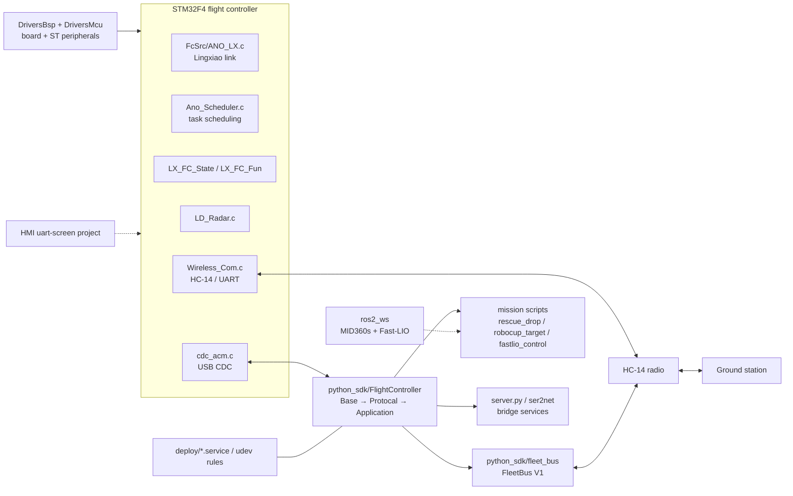
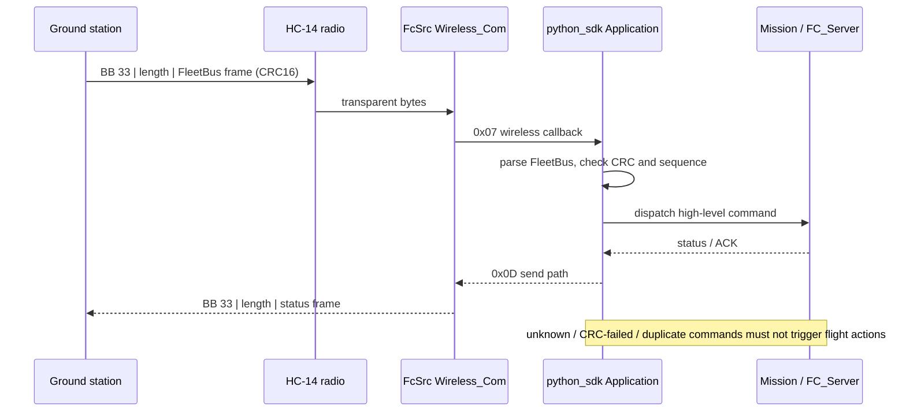

# System Architecture — Lingxiao (ANOTC-based) Flight Controller & Companion SDK

> **Scope**: architecture at `main` = `d5f1e24378a869cccf67f3b9ad91c9ce2c34795e` (2026-10-16).
> This repository contains **both** STM32F4 flight-controller firmware derived from
> ANOTC (匿名科创) official code **and** the Python/ROS 2 companion-side software.
> Upstream attribution is a hard requirement and is preserved in §1.

## 1. Provenance boundary (read this first)

`readme.md` states that the flight-controller portion is **based on ANOTC official
code**. The repository is therefore a mix of:

| Layer | Origin | Where |
|---|---|---|
| Flight-controller firmware | ANOTC (匿名科创) upstream + local integration | `FcSrc/`, `DriversBsp/`, `DriversMcu/`, `HMI/` |
| Third-party USB stack | CherryUSB (Apache-2.0), CMSIS-DAP, FatFs | `ThirdParty/` |
| Companion Python SDK and missions | local work | `python_sdk/` |
| ROS 2 localization workspace | local integration (MID360s / Fast-LIO) | `ros2_ws/` |
| Deployment units | local work | `deploy/` |

Do **not** describe the whole repository as an original flight-controller
implementation. The `匿名--凌霄--飞控手册.V1.07pdf.pdf` manual is upstream vendor
documentation.

## 2. Diagram A — system panorama

## 3. Diagram B — ground-to-air command path (FleetBus V1)

## 4. Component evidence

| Component | Role | Evidence @ `d5f1e243` | Status |
|---|---|---|---|
| `FcSrc/main.c` | Firmware entry / init | `FcSrc/` | production |
| `FcSrc/ANO_LX.c`, `ANO_DT_LX.c` | Lingxiao protocol and telemetry | `FcSrc/` | upstream-derived |
| `FcSrc/Ano_Scheduler.c` | Cooperative task scheduler | `FcSrc/` | upstream-derived |
| `FcSrc/LX_FC_State.c`, `LX_FC_Fun.c` | FC state machine and functions | `FcSrc/` | upstream-derived |
| `FcSrc/Wireless_Com.c` | HC-14/UART wireless transport | `details.md` §3 (`0x0D`/`0x07`, `BB 33`) | production |
| `FcSrc/User_Com.c`, `User_Task.c` | SDK/user protocol and tasks | `FcSrc/` | production |
| `python_sdk/FlightController/Base.py`, `Protocal.py`, `Application.py` | Python FC protocol stack | `python_sdk/FlightController/` | production |
| `python_sdk/FlightController/Components/GroundStationLink/` | Legacy HMAC ground link (V2) | `link.py`, `protocol.py`, `service.py` | legacy/alternate |
| `python_sdk/fleet_bus/` | FleetBus V1 (CRC16) share with `stm` | `fleet_bus/` | production |
| `python_sdk/server_ros.py` | Hosts `FC_Server`, which owns the FC serial; `FC_Client` forwards calls over TCP so task scripts do not open the serial themselves | `python_sdk/` | production |
| `python_sdk/*.py` mission scripts | Rescue drop, target detection, Fast-LIO control | `python_sdk/` | production/experimental mix |
| `ros2_ws/` | MID360s + Fast-LIO localization configuration and patches | `ros2_ws/` | optional |
| `deploy/` | systemd units, udev rules, installation scripts | `deploy/` | deployment |
| `ThirdParty/CherryUSB/` | USB stack (Apache-2.0) | `ThirdParty/CherryUSB/LICENSE` | third-party |

## 5. Protocol facts verified in this repository

- `details.md` §3: FleetBus V1 frame = `payload + CRC16-CCITT-FALSE`; max payload
  220 bytes; **no HMAC** (the HMAC belongs to the older GroundStationLink V2 path).
- Wireless bridge envelope: `BB 33 | bridge_len:u8 | FleetBus frame`.
- FC wireless path uses `0x0D` to send and `0x07` for the wireless callback.
- `details.md` §7 safety boundary: the ground station sends only high-level task
  commands, never real-time attitude/velocity setpoints; STOP is idempotent.

## 6. Safety and failure behaviour (documented)

- Unknown, CRC-failed or duplicated commands must not trigger a new flight action.
- STOP has priority and is idempotent.
- The ground station must not open `/dev/ttyACM0` when the FC owns it (`details.md` §1).
- Serial paths and radio parameters are environment-specific; see `details.md` §1–§2.
- **Single serial owner**: when `server_ros.py` (`FC_Server`) is running it owns the
  FC serial port; new scripts must use `FC_Client` rather than opening the port
  directly, otherwise two processes would compete for the same device.

## 7. Validation and limitations

- `details.md` §5 records logic-level checks (12 onboard + 38 ground-station tests,
  byte-identical frames) and that the wireless bridge was confirmed online. It also
  requires unknown/real-flight conditions to be marked **not verified**.
- A tracking archive `fc_logs_from_fc_20260726_1303_complete.tar.gz` exists; its
  contents are not analysed in this document.
- Firmware behaviour is derived from upstream ANOTC code; no claim is made that the
  inner control loops are original work.
- No root LICENSE. Third-party licenses are retained under `ThirdParty/`; ST
  StdPeriph/CMSIS headers retain ST copyright.
